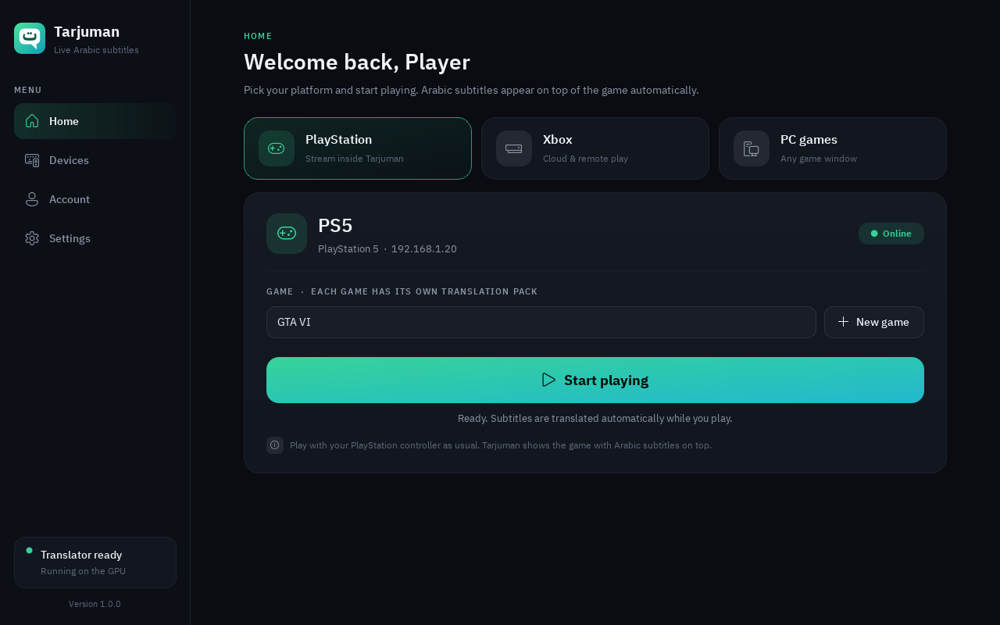
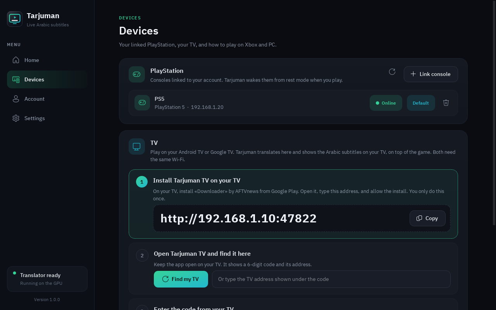
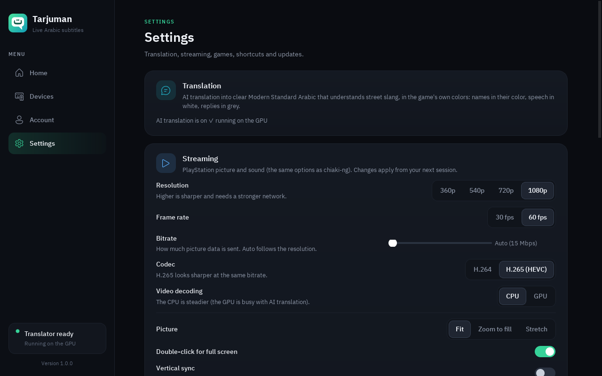

<div align="center">


# Tarjuman

**Live Arabic subtitles for your games.** PlayStation, Xbox, PC and TV.

[**Download for Windows**](https://github.com/hokagex7/tarjuman/releases/latest/download/Tarjuman-Setup.exe) · [**TV app (Android TV)**](https://github.com/hokagex7/tarjuman/releases/latest/download/Tarjuman-TV.apk) · [All downloads](https://github.com/hokagex7/tarjuman/releases/latest)



</div>

## What it does

Tarjuman reads the English subtitles of your game the moment they appear and shows a clear Arabic translation on top of the game, while you play.

- **Natural Arabic.** AI translation into clear Modern Standard Arabic (فصحى) that understands street slang and idioms. It translates the meaning, not word by word.
- **Looks like the game.** Speaker names keep the game's colors, speech is white and replies are grey, with the same punctuation as the original line.
- **PlayStation 5 and 4.** Stream your console inside Tarjuman at up to 1080p and 60 fps, and play with your controller as usual. Tarjuman wakes the console from rest mode for you.
- **Xbox and PC games.** Pick any game window (Xbox cloud or remote play, or a PC game) and the subtitles appear on top of it.
- **On your TV.** The Tarjuman TV app shows the Arabic subtitles on your Android TV or Google TV, over the game.
- **Learns as you play.** Every game keeps its own translation pack. Fix a line once and it stays fixed.
- **Private.** Everything runs on your PC. Not a single line is sent to the internet.

<div align="center">
 
</div>

## Download

| | Platform | File |
|---|---|---|
| 💻 | **Windows 10 / 11** (64-bit) | [Tarjuman-Setup.exe](https://github.com/hokagex7/tarjuman/releases/latest/download/Tarjuman-Setup.exe) |
| 📺 | **Android TV / Google TV** | [Tarjuman-TV.apk](https://github.com/hokagex7/tarjuman/releases/latest/download/Tarjuman-TV.apk) |

Tarjuman updates itself. New versions appear in the app under **Settings › Check for updates**.

## Install on your TV (with Downloader)

1. On your TV, install **Downloader** by AFTVnews from Google Play.
2. Open Downloader and type this address:

   ```
   https://github.com/hokagex7/tarjuman/releases/latest/download/Tarjuman-TV.apk
   ```

3. Allow the install, then open **Tarjuman TV**. It shows a 6-digit code.
4. On your PC, open Tarjuman › **Devices** › **TV**, press **Find my TV** and type the code.

> Tip: Tarjuman on your PC can also serve the TV app over your home network. The address is shown in **Devices › TV › step 1**.

## Getting started

1. Install Tarjuman on your PC and open it.
2. **PlayStation:** on the console, turn on *Settings › System › Remote Play › Enable Remote Play*. In Tarjuman, sign in with your PlayStation account and link the console with the 8-digit code (you only do this once).
3. **AI translation:** Tarjuman downloads the AI files once (about 5 GB). Until then it uses standard translation.
4. Press **Start playing**.

## Requirements

- Windows 10 or 11, 64-bit.
- An NVIDIA graphics card for AI translation (recommended).
- PlayStation, PC and TV on the same home network.

## Built with

[chiaki-ng](https://github.com/streetpea/chiaki-ng) (streaming engine, AGPL-3.0) · [llama.cpp](https://github.com/ggml-org/llama.cpp) and Gemma (AI translation) · [OPUS-MT](https://github.com/Helsinki-NLP/Opus-MT) (standard translation) · [pyremoteplay](https://github.com/ktnrg45/pyremoteplay) · [IBM Plex Sans Arabic](https://github.com/IBM/plex) (font, OFL) · Qt for Python.

Tarjuman is not affiliated with Sony Interactive Entertainment, Microsoft or any game publisher.
